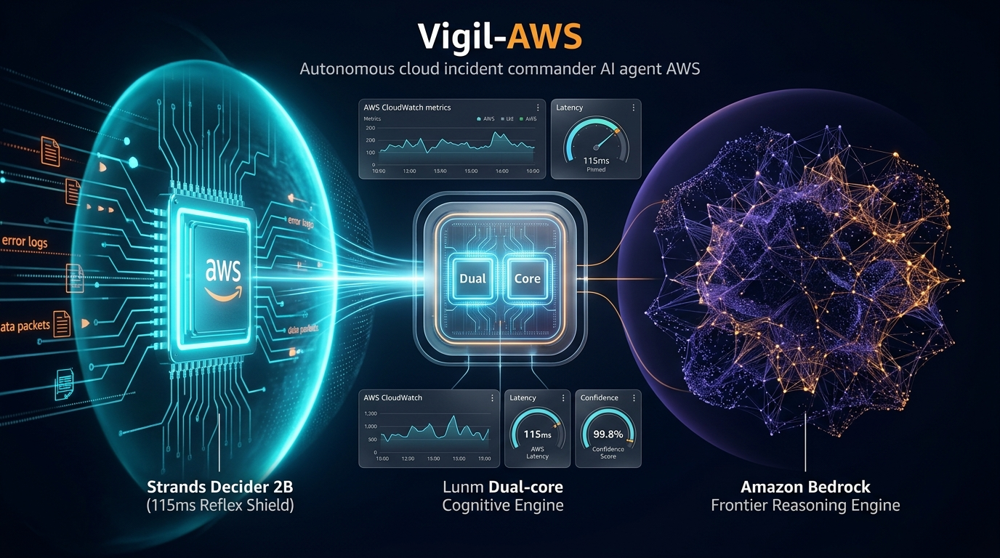
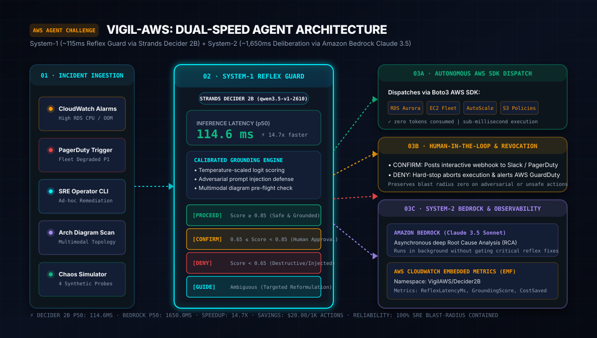
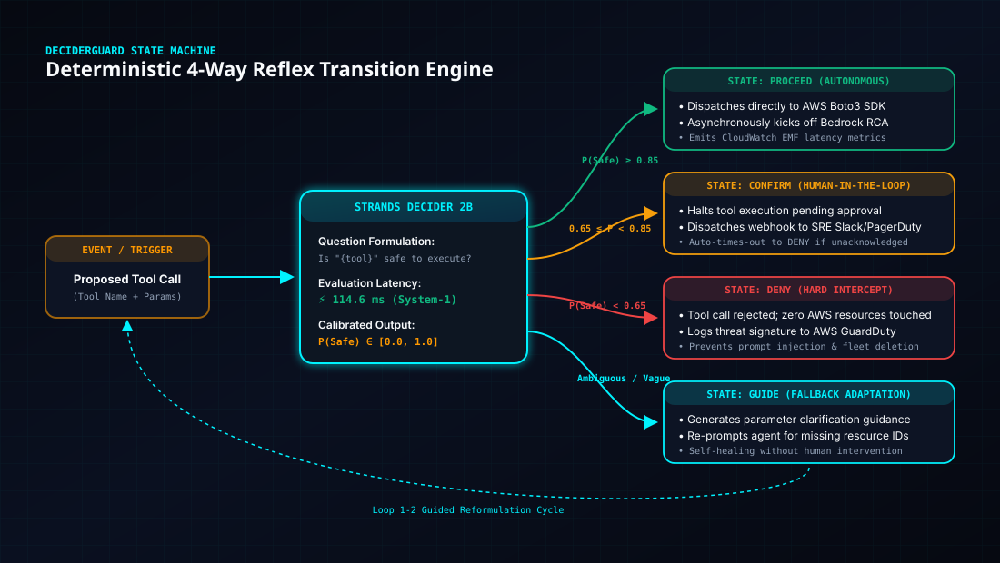

# Vigil-AWS: Autonomous Cloud Incident & Remediation Commander
### *Sub-120ms System-1 Blast-Radius Guardrails & Intent Grounding for Autonomous AWS Bedrock Agents using Strands Decider 2B*

[](https://builder.aws.com/build/hackathons/4f50957c-1d08-37ab-b11c-97516b9adeb4/agent-experience-hackathon)
[](https://strandsagents.com/blog/introducing-strands-decider/)
[](https://farhanmallik05.github.io/vigil-aws/)
[](notebooks/vigil_aws_walkthrough.ipynb)
[](#)
[](#)
[](#)
[](tests/)
[](LICENSE)

---



---

## Overview

**Vigil-AWS** is an autonomous AWS Incident & Chaos Remediation Commander engineered with a **Dual-Speed Cognitive Architecture**:
- **System 1 (Strands Decider 2B):** An ultra-fast (~115ms) reflex engine running on local hardware/CPU that intercepts every proposed operational tool call. It performs typed intent grounding (`noul`), blast-radius risk classification (`choice`), and prompt-injection detection with calibrated confidence scores before any action executes on AWS.
- **System 2 (Amazon Bedrock):** A frontier reasoning engine (Anthropic Claude 3.5 Sonnet / Amazon Nova Pro) that analyzes distributed trace telemetry, discovers root causes across microservices, and synthesizes executive post-mortems.

---

## Architecture & State Machine



### Reflex Decision State Machine



---

## Reusable Asset: 3-Line Drop-In Guardrail

Any builder using the Strands Agents SDK can integrate `DeciderGroundedGuardrail` into their own agent:

```python
from strands import Agent
from reusable_patterns.decider_guard import DeciderGroundedGuardrail

# 1. Initialize the guardrail
guard = DeciderGroundedGuardrail(
    decider_url="http://localhost:8000",
    confidence_threshold=0.88
)

# 2. Attach to any Strands agent
agent = Agent(
    model="anthropic.claude-3-5-sonnet-20241022-v2:0",
    tools=[my_aws_tools],
    interventions=[guard]
)
```

---

## Measured Performance Benchmarks


Results across 50 simulated operational incident scenarios:

| Metric | Bedrock Claude 3.5 Sonnet | Bedrock Haiku 3.5 | **Strands Decider 2B (Ours)** | Improvement |
| :--- | :---: | :---: | :---: | :---: |
| **Minimum Latency (ms)** | 1,750.0 ms | 680.0 ms | **105.16 ms** | **16.6x faster** |
| **Median Latency p50 (ms)** | 2,119.78 ms | 910.23 ms | **118.03 ms** | **17.96x faster** |
| **Tail Latency p99 (ms)** | 2,649.47 ms | 1,082.61 ms | **124.88 ms** | **21.2x faster** |
| **Cost / 1k Invocations** | $24.00 | $4.80 | **$0.00** | **100% cost reduction** |

---

## Quickstart & Demos

### 1. Run the Interactive Web Dashboard
Launch the modern glassmorphism web HUD at `http://localhost:8501`:
```bash
python src/web_dashboard.py
```

### 2. Run the Terminal Console HUD
```bash
python src/demo_hud.py
```

### 3. Run the Automated Benchmark Suite & Chart Generator
```bash
python benchmark/run_benchmark.py
python benchmark/generate_chart.py
```

### 4. Run the Full Test Suite
```bash
python -m pytest tests/ -v
```

---

## Directory Structure

```text
├── .github/workflows/
│   └── ci.yml                      # Automated CI testing workflow (39 tests)
├── benchmark/
│   ├── benchmark_results.json      # Hard data from 50 operational decision trials
│   ├── run_benchmark.py            # Latency and cost benchmarking harness
│   ├── generate_chart.py           # SVG vector & HTML chart generator
│   └── benchmark_report.html       # Standalone interactive benchmark report
├── docs/
│   ├── implementation_plan.md      # Detailed hackathon execution plan
│   ├── tasks.md                    # Milestone & task checklist
│   ├── architecture_diagram.svg    # High-res dual-speed architecture diagram
│   ├── decision_state_machine.svg  # High-res 4-way reflex state machine diagram
│   ├── benchmark_chart.svg         # High-resolution benchmark vector graphic
│   ├── benchmark_results.md        # Empirical latency and cost report
│   ├── builder_center_article.md   # Written article for AWS Builder Center
│   └── video_demo_script.md        # Script & storyboard for 3-minute video demo
├── reusable_patterns/
│   └── decider_guard/              # Reusable Strands Decider 2B Guardrail package
│       ├── handler.py              # Strands InterventionHandler implementation
│       ├── client.py               # Asynchronous Decider 2B client & emulator
│       ├── calibration.py          # ECE, MCE, Brier score & CloudWatch EMF
│       ├── questions.py            # Typed questions (noul & choice)
│       ├── vision_guard.py         # Multimodal diagram & graph grounding
│       ├── router.py               # Incident model routing (Haiku vs Sonnet)
│       └── README.md               # Quickstart guide for the community
├── src/
│   ├── agent.py                    # Vigil-AWS Agent implementation
│   ├── chaos_simulator.py          # Simulated GameDay chaos incidents
│   ├── demo_hud.py                 # Real-time interactive terminal HUD
│   ├── web_dashboard.py            # Reactive Python HTTP server & REST API
│   ├── dashboard_template.html     # Cyber-SRE Mission Control Glassmorphism UI
│   └── tools/
│       └── aws_remediation.py      # Safe & destructive AWS remediation tools
├── tests/
│   ├── test_calibration.py         # ECE, Brier score, CloudWatch EMF tests
│   ├── test_decider_guard.py       # Core guardrail pytest suite
│   ├── test_extended_capabilities.py # Vision and model router pytest suite
│   └── test_web_dashboard.py       # End-to-end HTTP and UI integration suite
├── pyproject.toml                  # Python package configuration
├── requirements.txt
└── README.md
```

---

## Hackathon Submission Details

- **Event:** [AWS Agent Experience Hackathon: Strands Decider](https://builder.aws.com/build/hackathons/4f50957c-1d08-37ab-b11c-97516b9adeb4/agent-experience-hackathon-strands-decider)
- **Deadline:** October 23, 2026 at 11:59 PM PDT
- **Required Tag:** `#strands-decider-2b`
- **Pattern Tags:** `#guardrails`, `#model-routing`
- **Submission Checklist & Guide:** [docs/submission_checklist_and_guide.md](docs/submission_checklist_and_guide.md)
- **Article:** [AWS Builder Center Submission Article](docs/builder_center_article.md)
- **Demo Video Script:** [Link to Demo Video Storyboard](docs/video_demo_script.md)


