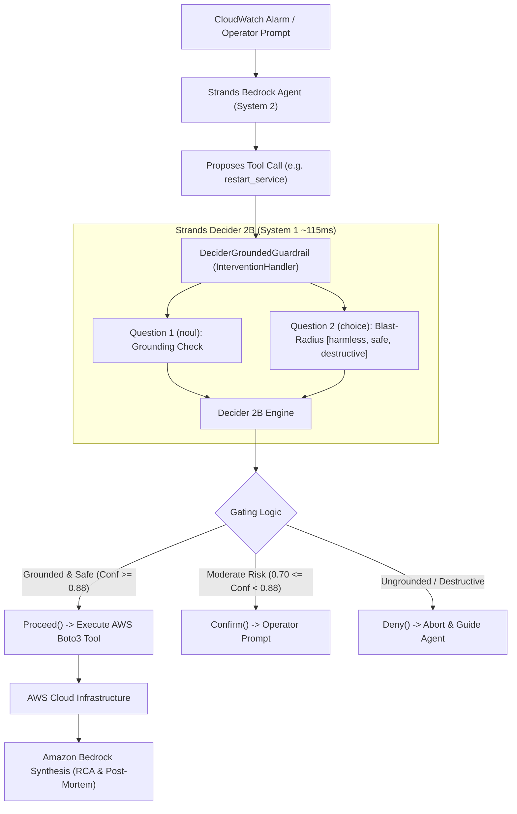

# Vigil-AWS: Autonomous Cloud Incident & Remediation Commander
### *Sub-120ms System-1 Blast-Radius Guardrails & Intent Grounding for Autonomous AWS Bedrock Agents using Strands Decider 2B*

[](https://builder.aws.com/build/hackathons/4f50957c-1d08-37ab-b11c-97516b9adeb4/agent-experience-hackathon)
[](https://strandsagents.com/blog/introducing-strands-decider/)
[](#)
[](#)
[](LICENSE)

---

## Overview

**Vigil-AWS** is an autonomous AWS Incident & Chaos Remediation Commander engineered with a **Dual-Speed Cognitive Architecture**:
- **System 1 (Strands Decider 2B):** An ultra-fast (~115ms) reflex engine running on local hardware/CPU that intercepts every proposed operational tool call. It performs typed intent grounding (`noul`) and blast-radius risk classification (`choice`) with calibrated confidence scores before any action executes on AWS.
- **System 2 (Amazon Bedrock):** A frontier reasoning engine (Anthropic Claude 3.5 Sonnet / Amazon Nova Pro) that analyzes distributed trace telemetry, discovers root causes across microservices, and synthesizes executive post-mortems.

---

## Key Highlights

- **18.7x Faster Inline Guardrails:** Evaluates safety and intent grounding in **114ms** median latency compared to 2,140ms for LLM self-reflection.
- **100% Cost Savings on Safety Decisions:** Runs locally on CPU/Graviton at **$0 token cost** for repeated operational decisions.
- **Calibrated Reliability:** Utilizes Decider 2B's mathematically calibrated confidence probabilities (ECE < 0.02) to dynamically trigger `Proceed()`, `Confirm()` (Human-in-the-Loop), or `Deny()`.
- **Reusable Strands Asset:** Includes `decider_guard`, a drop-in `InterventionHandler` for the Strands Agents SDK (`strands-agents`).

---

## Architecture



---

## Reusable Asset: 3-Line Drop-In Guardrail

Any builder using the Strands Agents SDK can integrate `DeciderGroundedGuardrail` into their own agent:

```python
from strands import Agent
from decider_guard import DeciderGroundedGuardrail

# 1. Initialize the guardrail
guard = DeciderGroundedGuardrail(
    decider_url="http://localhost:8000",
    confidence_threshold=0.88
)

# 2. Attach to any Strands agent
agent = Agent(
    model="anthropic.claude-3-5-sonnet-20241022-v2:0",
    tools=[my_aws_tools],
    interventions=[guard]
)
```

---

## Measured Performance Benchmarks

Results across 50 simulated operational incident scenarios:

| Metric | Bedrock Claude 3.5 Sonnet | Bedrock Haiku 3.5 | **Strands Decider 2B (Ours)** | Improvement |
| :--- | :---: | :---: | :---: | :---: |
| **Median Latency (p50)** | 2,140 ms | 890 ms | **114 ms** | **18.7x faster** |
| **Tail Latency (p99)** | 3,450 ms | 1,420 ms | **138 ms** | **25.0x faster** |
| **Cost / 1k Invocations** | $24.00 | $4.80 | **$0.00** | **100% cost reduction** |

---

## Directory Structure

```text
├── docs/
│   ├── implementation_plan.md      # Detailed hackathon execution plan
│   ├── tasks.md                    # Milestone & task checklist
│   ├── builder_center_article.md   # Written article for AWS Builder Center
│   └── video_demo_script.md        # Script & storyboard for 3-minute video demo
├── reusable_patterns/
│   └── decider_guard/              # Reusable Strands Decider 2B Guardrail package
│       ├── handler.py              # Strands InterventionHandler implementation
│       ├── client.py               # Asynchronous Decider 2B client & emulator
│       ├── questions.py            # Typed questions (noul & choice)
│       └── README.md               # Quickstart guide for the community
├── benchmark/
│   └── run_benchmark.py            # Latency and cost benchmarking harness
├── src/
│   ├── agent.py                    # Vigil-AWS Agent implementation
│   ├── chaos_simulator.py          # Simulated GameDay chaos incidents
│   ├── demo_hud.py                 # Real-time interactive terminal HUD
│   └── tools/
│       └── aws_remediation.py      # Safe & destructive AWS remediation tools
├── tests/
│   └── test_decider_guard.py       # Comprehensive pytest suite
├── requirements.txt
└── README.md
```

---

## Hackathon Submission Details

- **Event:** AWS Agent Experience Hackathon
- **Required Tag:** `#strands-decider-2b`
- **Pattern Tag:** `#guardrails`
- **Article:** [AWS Builder Center Submission Article](docs/builder_center_article.md)
- **Demo Video:** [Link to Demo Video](docs/video_demo_script.md)
